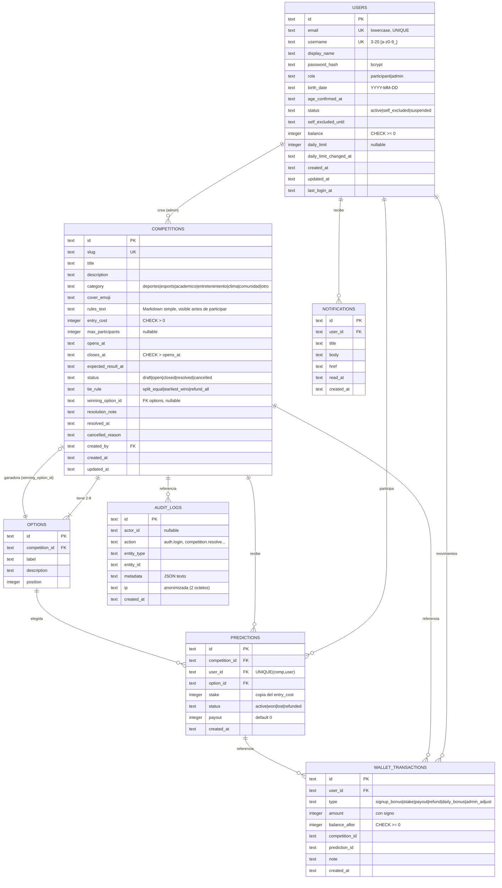

# MODELO DE DATOS — Goopo

SQLite (libSQL) con Drizzle ORM. IDs texto (`nanoid`/UUID), fechas ISO-8601 UTC en texto, dinero entero (Goopos sin decimales), `PRAGMA foreign_keys = ON`.

## Diagrama ER (Mermaid)

## Invariantes clave

1. **UNIQUE(`competition_id`,`user_id`) en `predictions`** → una sola participación por usuario por competencia (a nivel de índice único, además del check de negocio).
2. **Ledger cuadrado**: para cada usuario, `users.balance == SUM(wallet_transactions.amount)`. Verificado al sembrar (`assertSeedConsistency`) y en los tests de dominio.
3. **Pozo exacto**: al resolver, `SUM(payout + pagos) == SUM(stake)`. Lo calcula siempre el motor puro `computePayouts` que lanza error si se rompe el invariante.
4. **Immutabilidad**: competencias `resolved`/`cancelled` (y predicciones no `active`) no admiten cambios a nivel de servicio.
5. **Índices**: `competitions(status,closes_at)`, `competitions(category)`, `predictions(user_id,created_at)`, `predictions(competition_id)`, `wallet_transactions(user_id,created_at)`, `audit_logs(created_at)`, `notifications(user_id,read_at)`.

## Migraciones

El SQL DDL versionado vive en `src/server/db/migrate.ts` (idempotente, `CREATE TABLE IF NOT EXISTS`), ejecutado en runtime por `ensureDb()` y por CLI en `npm run db:migrate`. De este modo Vercel puede arrancar sin preconfiguración.
